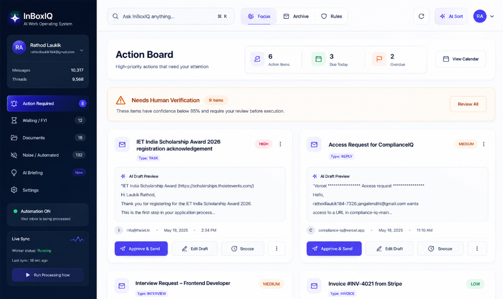
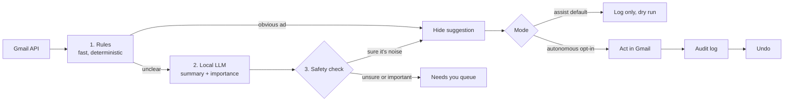

<div align="center">



# InBoxIQ

### The Gmail assistant that asks before it acts.

An AI inbox sorter that runs on your own laptop, never hides mail on a guess, and can undo everything it does.

[](https://github.com/Laukikrathod2007/InBoxAI--Final/actions/workflows/ci.yml)


**Built by [Laukik Rathod](https://github.com/Laukikrathod2007)**

[**Try it in your browser**](https://huggingface.co/spaces/Laukik007/inboxiq#/try) · [How it works](#how-it-works) · [Results](#results) · [Quick start](#quick-start) · [Security](SECURITY.md) · [Decisions](DECISIONS.md)

</div>

---

## The story in 30 seconds

I built the first version at the end of my second year. It looked great in a demo. Then I measured it on 50 of my own real emails, and it was **hiding 57.6% of the important ones**.

So I stopped adding features and fixed the system instead. I rebuilt the filter around one rule: **never hide mail on a guess.** Then I measured again.

| | Before | After |
|---|---|---|
| Important mail wrongly hidden | **57.6%** | **0.0%** |
| Needs-action mail hidden | 66.7% | 0.0% |

The sample is small (50 emails), and I say so below. The numbers are real, the method is in the repo, and you can rerun it on your own mail.

---

## What it does

| | |
|---|---|
| **Sorts your inbox** | Reads new Gmail, filters obvious ads with rules, then a local AI model summarizes each email and scores how much it needs you. |
| **Asks when unsure** | Anything the model is unsure about goes to a "Needs you" queue. It does not hide on a guess. |
| **Suggests first** | By default it only logs what it would do (dry run). Your Gmail is not changed until you switch it on. |
| **Undoes mistakes** | Every real action is logged after Gmail confirms it, and has an Undo button. |
| **Drafts replies** | Say what you want ("say yes to Friday"). The model writes it. You edit and confirm before anything is sent. |
| **Answers questions** | Ask your inbox things in plain language. |
| **Reads PDFs** | Pulls key fields out of invoices, resumes, and contracts. |

---

## Why not just use Gmail's built-in AI?

| | Gmail / Gemini features | InBoxIQ |
|---|---|---|
| Where the AI runs | Google's cloud | **Your laptop** (Ollama) |
| Who reads your mail | Processed on Google's servers | Stays on your machine unless you add a cloud key |
| Default behavior | Built-in features decide for you | **Suggests only**, you opt in to actions |
| Mistakes | Not something you can inspect | **Logged and undoable** |
| Rules | Closed | **Open source, readable, testable** |
| Cost | Tied to Google's plans | Free to run locally |

I am not claiming it is smarter than Google's models. The point is control, privacy, and being able to check its work.

---

## How it works



Each new email goes through a LangGraph pipeline:

1. **Ingest** the email, thread, and attachment info from Gmail.
2. **Rules first.** Cheap, deterministic filters catch obvious promotions in milliseconds, so the model is not wasted on them.
3. **Extract** structured data from PDF attachments.
4. **Classify** with a local model: summary, category, importance, deadlines.
5. **Decide.** A low importance score alone never hides mail. Unsure goes to review.
6. **Store, then act or suggest** depending on the mode, with an audit entry for every action.

### Design decisions that matter

- **Rules before the model.** A cheap rule is faster and can be tested exactly. The model only sees what rules cannot decide.
- **A guess never archives.** My first version let a low model score archive mail. That was the main cause of the 57.6%.
- **Dry run by default.** Trust is earned. The user turns actions on.
- **Evidence over opinion.** Rules tuned on synthetic data still failed on real mail (30% wrongly hidden). I only trusted the real-mail result. See [DECISIONS.md](DECISIONS.md), including the ideas I tested and rejected.

---

## Results

### Real mail: my own inbox, 50 emails, labelled by hand
Labels: 17 noise, 18 FYI, 15 needs-action. The emails and labels stay on my machine (gitignored).

| System | Noise hidden | Precision | Important mail wrongly hidden | Needs-action mail hidden |
|---|---|---|---|---|
| Hide nothing (baseline) | 0% | n/a | 0% | 0% |
| App as it originally ran | 52.9% | 32.1% | **57.6%** | **66.7%** |
| Rules v2 (tuned on synthetic data) | 29.4% | 33.3% | 30.3% | 26.7% |
| **Rules v3 (current)** | 17.6% | 100% | **0.0%** | **0.0%** |

The rules now hide less noise on purpose. The rest is left for you to review instead of being hidden. 50 emails is a small sample: one wrong hide would move the number by about 3 points.

### Synthetic mailbox: 150 labelled emails, runs in CI
This is a regression guard, not proof. I wrote it alongside the rules, so it overstates accuracy: v2 scored 0% wrongly hidden here and 30% on real mail.

### Speed
Measured on my own laptop CPU: rule-filtered mail finishes in milliseconds. Mail that goes to the model took a median of about 22.5 s with llama3 8B. `llama3.2:3b` was about 2x faster (median 10.5 s). Live numbers: `GET /api/metrics`.

### Known limits
- Tested on one person's mail (mine). No multi-user results yet.
- Prompt-injection behavior is not tested.
- Login is a local token for one user on one PC. It is not a multi-user login.
- The Docker image was built and run locally, not in a hosted environment.

---

## Security

Local-first by design, and honest about the limits. Full table in [SECURITY.md](SECURITY.md).

- Binds to `127.0.0.1`. CORS allowlist, Origin and Host checks, security headers and CSP, rate limits.
- Local API token for the dashboard.
- Gmail token stored in the OS credential vault (Windows Credential Manager, macOS Keychain) with a file fallback.
- Confirm-before-send, bound to the specific thread.
- Logs are redacted. Email bodies are erased after 30 days.
- `pip-audit` and `npm audit` run in CI. Both reported no known vulnerabilities at last check.

---

## Try it

**In your browser, no sign-up:** the [`#/try` page](https://huggingface.co/spaces/Laukik007/inboxiq#/try) runs the real `src/rules.py` in your browser through Pyodide. Paste an email and see the decision. Nothing leaves the page. (This demo does not include the AI model.)

**Local demo with fake mail:** `python scripts/demo_server.py`, then open http://127.0.0.1:8002. It loads 80 synthetic emails and never contacts Gmail or a model.

---

## Quick start

**You need:** Python 3.10+, Node 18+, [Ollama](https://ollama.ai) (`ollama pull llama3` or `llama3.2:3b`), and a Google Cloud project with the Gmail API enabled (`gmail_credentials.json`).

```bash
git clone https://github.com/Laukikrathod2007/InBoxAI--Final.git
cd InBoxAI--Final
cp .env.example .env            # keep AUTOPILOT_MODE=assist to start
pip install -r requirements.txt
cd frontend && npm install && npm run build && cd ..
python scripts/gmail_login.py   # sign in through the browser
python run_app.py               # opens http://127.0.0.1:8001
```

Windows: double-click **`Launch InBoxIQ.bat`** or run `setup_and_run.ps1`.

Google apps in testing mode expire tokens about weekly. Rerun `scripts/gmail_login.py` when that happens.

### Modes

| `AUTOPILOT_MODE` | What happens |
|---|---|
| `off` | Nothing is done. |
| `assist` (default) | Logs what it would do. Gmail is not changed. |
| `autonomous` | Acts in Gmail, logs every action, supports Undo. Try it on a spare account first. |

---

## Tech stack

| Layer | Technology |
|---|---|
| Frontend | React 19, Vite, Tailwind CSS v4 |
| Backend | FastAPI, SQLAlchemy, SQLite |
| AI workflow | LangGraph |
| Local model | Ollama (llama3, llama3.2:3b) |
| Gmail | Gmail API v1, OAuth 2.0 |
| PDFs | PyMuPDF |
| Quality | pytest (63 tests), ESLint, GitHub Actions, pip-audit, npm audit |

---

## Repo map

```
src/        FastAPI app, LangGraph brain, rules, autopilot, security modules
frontend/   React app, landing page, in-browser demo
eval/       Evaluation harness: synthetic set and real-mail scoring
tests/      Unit and API tests
docs/       Video script, write-up draft
```

Further reading: [ARCHITECTURE.md](ARCHITECTURE.md) · [DECISIONS.md](DECISIONS.md) · [RISKS.md](RISKS.md) · [RUNBOOK.md](RUNBOOK.md) · [SECURITY.md](SECURITY.md)

---

## Roadmap

- Weeks of real use, then measure the sender-memory feature (it learns noise senders after 2 mutes).
- Evaluate on more than one person's mail.
- Prompt-injection tests.
- Google Calendar integration and multi-account support.

---

<div align="center">

MIT License · Designed and built by [Laukik Rathod](https://github.com/Laukikrathod2007) · FastAPI, React, LangGraph, and local models.

**Local-first. Measured. Reversible by default.**

</div>
